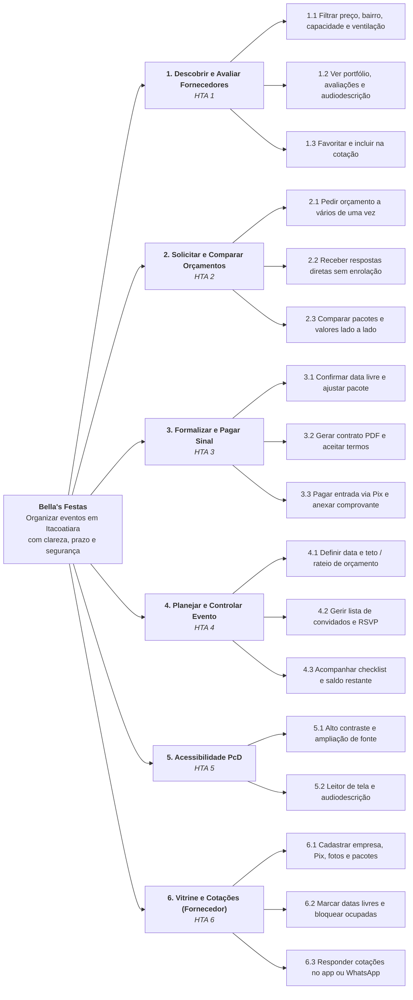
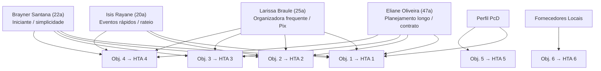

# Mapa de Objetivos — Bella's Festas

## Introdução

O **Mapa de Objetivos** consolida as intenções, dores e expectativas identificadas na etapa de **Imersão** (Briefing, Matriz CSD e Pesquisa com Usuários) e sintetizadas nas **Personas** e na **Metamensagem do Sistema Bella's Festas**[cite: 2, 10, 14, 15].

Alinhado à proposta comunicada na Metamensagem — de conectar moradores de Itacoatiara a fornecedores e artistas independentes da região, permitindo tanto **buscas rápidas e pontuais** quanto o **planejamento completo de ponta a ponta** —, este mapa organiza o que cada perfil deseja alcançar[cite: 14, 15]. Cada objetivo principal desdobra-se em subobjetivos acionáveis que fundamentam diretamente a **Análise Hierárquica de Tarefas (HTA)** e a modelagem de diálogo no **MoLIC**[cite: 1, 2].

---

## Gráficos do Mapa de Objetivos

### 1. Árvore de Objetivos e Subobjetivos

### 2. Conexão entre Perfis, Objetivos e HTAs

---

## Alinhamento com a Metamensagem e Personas

Conforme estabelecido na **Metamensagem**, o sistema atende moradores de Itacoatiara com diferentes níveis de experiência em organização e familiaridade tecnológica, oferecendo **dois modos principais de apropriação**[cite: 14, 15]:

1. **Uso Pontual (Agilidade):** Voltado a quem precisa resolver demandas específicas rapidamente — buscar espaços/serviços, verificar disponibilidade e comparar preços lado a lado sem enrolação[cite: 14, 15].
2. **Uso de Ponta a Ponta (Central de Planejamento):** Voltado ao acompanhamento completo do evento até o dia da festa — integrando orçamento, lista de convidados, checklist, contratos e pagamentos[cite: 14, 15].

### Perfis e Personas Atendidas
* **Isis Rayane (20 anos — Organizadora Ocasional / Confraternizações):** Planeja eventos em 1 a 2 semanas com rateio entre participantes (~R$ 30/pessoa)[cite: 11]. Busca proximidade, preços acessíveis, garantia de quantidade suficiente no buffet e facilidade para organizar e comunicar convidados[cite: 11].
* **Eliane Oliveira (47 anos — Planejadora de Eventos Familiares e Grandes Comemorações):** Planeja com antecedência (até 2 anos) priorizando o controle financeiro[cite: 12]. Rejeita enrolação no orçamento, exige ver trabalhos anteriores e avaliações reais e só paga entrada mediante contrato formal[cite: 12].
* **Larissa Macedo Braule (25 anos — Organizadora Frequente):** Organiza eventos semanalmente/mensalmente[cite: 13]. Sofre com a pesquisa cansativa em redes sociais, falta de objetividade nos valores e ausência de dados claros dos locais (vídeos, capacidade, ventilação)[cite: 13]. Valoriza comparação lado a lado e pagamento via Pix[cite: 13].
* **Brayner Santana (22 anos — Organizador Iniciante):** Sem afinidade com organização ou ferramentas complexas; planeja festas rápidas dividindo custos entre amigos[cite: 10]. Precisa de simplicidade, calendário de disponibilidade, orçamento rápido, contato via WhatsApp e pagamento intermediado[cite: 10].
* **Perfis Complementares (Acessibilidade PcD e Fornecedores/Artistas Locais):** Garantem autonomia de navegação para pessoas com deficiência e dão visibilidade profissional aos pequenos fornecedores e artistas independentes de Itacoatiara[cite: 2, 7, 8, 14].

---

## Desdobramento Hierárquico dos Objetivos

### Objetivo 1: Descobrir e Avaliar Fornecedores e Artistas Locais Confiáveis
* **Pilar da Metamensagem:** Dar visibilidade a prestadores de serviços, pequenos profissionais e artistas independentes de Itacoatiara em um só lugar, substituindo buscas dispersas por portfólios verificáveis[cite: 14, 15].
* **Personas vinculadas:** Larissa Macedo Braule, Eliane Oliveira, Isis Rayane e Brayner Santana[cite: 10, 11, 12, 13].
* **HTA correspondente:** `HTA 1: Buscar e Filtrar Fornecedores Locais`[cite: 2, 3]
* **Subobjetivos:**
  * **1.1 Localizar opções pelos critérios reais da festa:** Filtrar catálogo por categoria, faixa de preço, bairro/proximidade, capacidade de convidados e ventilação do espaço[cite: 2, 3, 11, 13].
  * **1.2 Validar qualidade e reputação:** Consultar fotos e vídeos de trabalhos anteriores e avaliações de clientes para evitar fornecedores pouco confiáveis ou perfis inativos[cite: 3, 10, 12, 13].
  * **1.3 Garantir acesso inclusivo ao catálogo:** Ouvir audiodescrição das fotos e descrições dos ambientes e serviços (recurso PcD)[cite: 3].
  * **1.4 Selecionar candidatos:** Favoritar fornecedores ou incluí-los diretamente na lista de cotação[cite: 3].

---

### Objetivo 2: Solicitar e Comparar Orçamentos com Rapidez e Transparência
* **Pilar da Metamensagem:** Eliminar a demora e a enrolação na negociação, permitindo solicitar e comparar propostas lado a lado com clareza de preço e itens inclusos[cite: 12, 13, 14, 15].
* **Personas vinculadas:** Brayner Santana, Larissa Macedo Braule, Eliane Oliveira e Isis Rayane[cite: 10, 11, 12, 13].
* **HTA correspondente:** `HTA 2: Solicitar e Comparar Orçamentos Lado a Lado`[cite: 4]
* **Subobjetivos:**
  * **2.1 Cotar múltiplos fornecedores em uma única etapa:** Selecionar duas ou mais empresas e informar uma única vez data/hora, tipo de festa e número de convidados[cite: 4].
  * **2.2 Receber respostas objetivas:** Obter retorno ágil com valores claros, pacotes definidos e disponibilidade confirmada[cite: 10, 12, 13].
  * **2.3 Comparar propostas lado a lado:** Analisar serviços, quantidade de itens/buffet, prazos e preços em tabela comparativa para escolher o melhor custo-benefício[cite: 4, 11, 13].

---

### Objetivo 3: Formalizar Contratação e Realizar Pagamentos com Segurança
* **Pilar da Metamensagem:** Oferecer tranquilidade e segurança na hora de fechar negócio, evitando alterações inesperadas de preço, indisponibilidade de data ou riscos na transferência de sinal[cite: 10, 12, 13, 14, 15].
* **Personas vinculadas:** Eliane Oliveira, Larissa Macedo Braule e Brayner Santana[cite: 10, 12, 13].
* **HTA correspondente:** `HTA 3: Formalizar Contratação e Pagar Sinal`[cite: 5]
* **Subobjetivos:**
  * **3.1 Confirmar data e escopo acordado:** Validar a data livre na agenda do fornecedor e ajustar detalhes finais do pacote[cite: 5].
  * **3.2 Formalizar o compromisso por escrito:** Gerar contrato em PDF com todas as condições combinadas e registrar o aceite digital dos termos[cite: 5, 12].
  * **3.3 Efetuar pagamento de entrada rastreável:** Realizar o pagamento do sinal via Pix (com chave registrada e anexo de comprovante) de forma intermediada e segura[cite: 5, 10, 13].

---

### Objetivo 4: Planejar e Controlar o Evento de Ponta a Ponta
* **Pilar da Metamensagem:** Atuar como central de planejamento flexível para eventos de poucos dias ou meses, integrando custos, convidados e tarefas até o dia da comemoração[cite: 14, 15].
* **Personas vinculadas:** Isis Rayane, Eliane Oliveira, Larissa Macedo Braule e Brayner Santana[cite: 10, 11, 12, 13].
* **HTA correspondente:** `HTA 4: Gerenciar Evento e Lista de Convidados`[cite: 5, 6]
* **Subobjetivos:**
  * **4.1 Configurar estrutura e orçamento do evento:** Definir nome, data e teto de gastos (incluindo divisão/rateio entre participantes)[cite: 5, 10, 11, 12].
  * **4.2 Organizar lista e confirmação de convidados:** Cadastrar participantes, enviar link de confirmação (RSVP) e acompanhar a contagem de confirmados[cite: 5, 6, 11].
  * **4.3 Monitorar tarefas e fluxo financeiro:** Gerenciar checklist de pendências e registrar pagamentos realizados para controlar o saldo restante[cite: 5, 6].

---

### Objetivo 5: Adaptar a Experiência às Preferências de Acessibilidade (PcD)
* **Pilar da Metamensagem:** Tornar o planejamento de festas acessível a todos os moradores de Itacoatiara, garantindo autonomia de navegação[cite: 2, 7, 14].
* **Personas vinculadas:** Usuários PcD (requisito transversal de acessibilidade)[cite: 2, 7].
* **HTA correspondente:** `HTA 5: Configurar Preferências de Acessibilidade (PcD)`[cite: 6, 7]
* **Subobjetivos:**
  * **5.1 Ajustar contraste e legibilidade visual:** Ativar modo de alto contraste e ampliar o tamanho da fonte pelo menu dedicado na tela inicial[cite: 6, 7].
  * **5.2 Configurar suporte auditivo e salvar perfil:** Ativar leitor de tela e audiodescrição de fotos, salvando o layout adaptado para toda a navegação[cite: 6, 7].

---

### Objetivo 6: Dar Visibilidade ao Negócio e Gerenciar Atendimentos (Fornecedor)
* **Pilar da Metamensagem:** Apoiar pequenos fornecedores, microempreendedores e artistas locais a divulgarem seus trabalhos, manterem agendas organizadas e responderem clientes com agilidade[cite: 2, 7, 8, 14, 15].
* **Personas vinculadas:** Fornecedores Locais e Artistas Independentes[cite: 2, 7, 8, 14].
* **HTA correspondente:** `HTA 6: Cadastrar Serviços e Responder Orçamentos (Fornecedor)`[cite: 7, 8]
* **Subobjetivos:**
  * **6.1 Estruturar vitrine profissional:** Cadastrar dados da empresa/chave Pix, categorias de atuação, redes sociais, fotos leves, pacotes com preços e capacidade[cite: 7, 8].
  * **6.2 Gerenciar calendário de disponibilidade:** Marcar datas livres e bloquear datas ocupadas para prevenir conflitos de agenda[cite: 7, 8].
  * **6.3 Atender solicitações de orçamento com agilidade:** Enviar propostas objetivas pelo aplicativo ou continuar o atendimento integrado via WhatsApp / chat interno[cite: 7, 8].

---

## Matriz de Rastreabilidade

